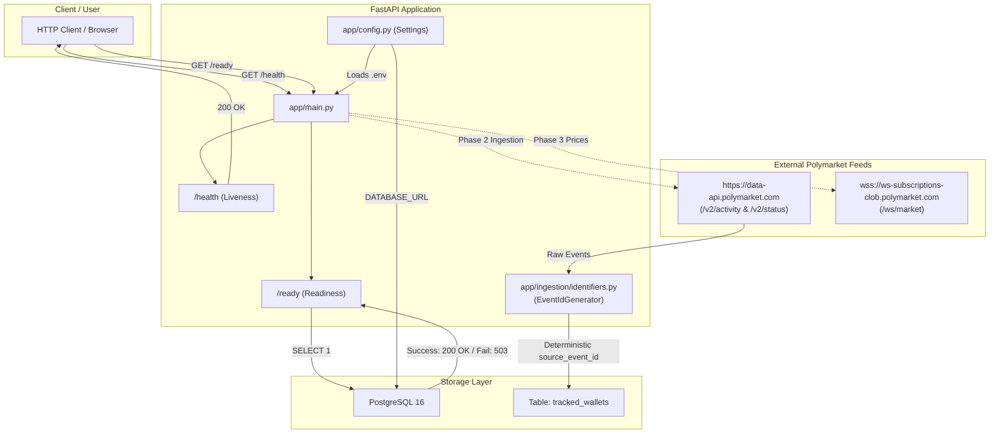

# Study Guide 01: Foundations & Real-World API Discovery

**Audience:** 3rd-year Computer Science student. You know basic programming and SQL, but you know nothing about prediction markets, financial accounting, or blockchains.  
**Phase:** 1 (Foundations & Close-Out)  
**Status:** Verified with passing tests and empirical live API spikes.

---

## 1. In One Minute
In this phase, we built the foundation of **PolyPulse**: a backend service that tracks trader wallets on Polymarket. We set up a clean Python 3.12 project with FastAPI, an asynchronous PostgreSQL 16 database connection using `psycopg 3`, and an initial database table called `tracked_wallets`. We wrote automated tests verifying address normalization, configuration loading, and health checks.

Before building any complex data processing, we ran live experiments (called **spikes**) against Polymarket's actual public servers. We learned how their Data API and WebSockets really behave in the wild:
1. **Cursor Pagination:** How historical feeds walk backwards through time using opaque tokens.
2. **Zero Auth Required:** Public read endpoints return `HTTP 200 OK` without any bearer token.
3. **Transaction Hash Non-Uniqueness:** Multiple fills exist in a single transaction, requiring a robust composite key and occurrence counter.
4. **Math Discrepancies:** On [MEASURED] 75 out of 2,261 trades, $\text{size} \times \text{price} \neq \text{usdc\_size}$, demonstrating why financial engines must record actual cash flows rather than naive multiplication.
5. **Zero-Payout Redeems:** Out of [MEASURED] 158 redeems, exactly [MEASURED] 80 paid \$0.00 (losing outcome shares), proving we must never assume a \$1.00/share payout.
6. **Real-Time Market WebSockets:** Verified `book`, `price_change`, and live `last_trade_price` streams, handling list-versus-object payloads and 10-second `PING`/`PONG` heartbeats.

---

## 2. Glossary

| Term | Plain Meaning | Where It Appears in Code |
| :--- | :--- | :--- |
| **Proxy Wallet** | A smart contract account on the Polygon blockchain that holds a user's money and market shares, rather than an externally owned private key wallet. | `app/storage/validation.py`, `scripts/spike_activity.py` |
| **Cursor Pagination** | A method of reading a long list of items using an opaque bookmark (a cursor string) pointing to the next item, instead of using page numbers. | `scripts/spike_activity.py` (`fetch_activity_history`) |
| **Health Check (`/health`)** | A quick web check that tells an external monitor: "The web application process is alive and taking requests." | `app/main.py` (`health_check`) |
| **Readiness Check (`/ready`)** | A web check that tells an external load balancer: "The service is ready to do real work because its backing database is reachable." | `app/main.py` (`readiness_check`) |
| **Decimal Arithmetic** | Fixed-point numerical representation that avoids the binary rounding errors inherent in IEEE 754 floating-point numbers. | `app/ingestion/identifiers.py` (`parse_json_with_decimal`) |
| **Occurrence Index** | A counter (0, 1, 2...) appended to an event's attributes to disambiguate identical fills that execute in the exact same transaction block. | `app/ingestion/identifiers.py` (`EventIdGenerator`) |
| **Zero-Payout Redeem** | A settlement event where a trader burns shares of a losing prediction outcome, yielding exactly \$0.00 USDC in return. | `docs/decisions/001-api-behavior.md`, `docs/decisions/002-accounting-boundary.md` |
| **Heartbeat (Keep-Alive)** | A periodic ping message sent over a live network connection to prove the client is still listening so the server doesn't disconnect it. | `scripts/spike_market_ws.py` (`heartbeat_sender`) |
| **Idempotence** | An operation that produces the exact same result no matter how many times you run it with the same input. | `tests/test_wallets.py` (`test_normalize_and_validate_idempotent`) |

---

## 3. Mental Model & Analogy

### Analogy 1: The Library Ledger and the Wax Bookmark
Imagine you are a researcher tasked with copying records from a giant, continuous physical scroll stored in a library archive.
* **Offset Pagination (the old way):** You tell the librarian: *"Give me records starting at line number 5,000."* If people added or deleted lines earlier that morning, your line numbers shift, and you either skip lines or read duplicates.
* **Cursor Pagination (our way):** The librarian gives you 500 lines along with a unique wax stamp (the **cursor**). When you return, you show that wax stamp. The librarian looks up the exact physical spot of that stamp and hands you the next batch. Even if new lines are added, you never lose your place.

### Analogy 2: The Cash Register Tape vs. The Shelf Tag
Imagine buying 5 apples at a supermarket where the shelf tag says \$0.50 each.
* If you calculate $5 \times \$0.50 = \$2.50$, you might expect the register to charge \$2.50.
* But when you look at the receipt, you were charged \$2.56 due to local sales tax or weighted variance.
* If an accounting ledger records \$2.50 instead of the actual \$2.56 taken from your wallet, the register balance is permanently corrupted.
* **In Polymarket:** `size * price` does not always equal `usdc_size`. The accounting engine must always record the actual cash transferred (`usdc_size`), never the theoretical multiplication.

---

## 4. Step-by-Step Explanation with Worked Numeric Examples

### Example 1: Address Normalization and Validation
* **Rule:** A valid Ethereum address must be a string that starts with `0x` followed by exactly 40 hexadecimal characters (0–9, a–f). Total length is $2 + 40 = 42$ characters.
* **Input:** `"  0x951634357346BB291dF117f9Ac410100FEea2104  "`
* **Step 1 (Clean whitespace):** Strip spaces $\rightarrow$ `"0x951634357346BB291dF117f9Ac410100FEea2104"`. Length is 42.
* **Step 2 (Regex validation):** Matches pattern `^0x[0-9a-fA-F]{40}$`. Valid.
* **Step 3 (Lowercase transformation):** Convert all uppercase letters (like `BB`, `FE`) to lowercase $\rightarrow$ `"0x951634357346bb291df117f9ac410100feea2104"`.
* **Idempotency proof:** If we run the output through the same function again:
  $$\text{normalize}(\text{"0x9516...2104"}) = \text{"0x9516...2104"}$$
  The second pass equals the first pass.

### Example 2: The Multi-Fill Transaction Collision & Occurrence Counter
During the spike on candidate wallet `AppleTiiime` (`0x951634357346bb291df117f9ac410100feea2104`), we loaded [MEASURED] 2,454 total events.
* Total transaction hashes: [MEASURED] 2,454.
* Unique transaction hashes: [MEASURED] 2,397.
* **Why the difference?** $2454 - 2397 = 57$ events shared transaction hashes with other events!
* **Case Study:** Transaction `0x5687a6fa64bb48db372704440c846b3f6cd68d6e4373212458a77f3227a1d773` had TWO fills:
  * Fill 1: Bought 1,346.73 shares of `Trail Blazers` for \$619.4958 USDC.
  * Fill 2: Bought 57.25 shares of `Trail Blazers` for \$26.335 USDC.
* **Math Check:** If we had keyed events by `(tx_hash, token_id, side)`, both fills have identical key `(0x5687..., 84271..., BUY)`. One fill would overwrite the other, dropping 57.25 shares from the trader's position!
* **Occurrence Counter Solution:** If two fills share identical attributes, the generator increments an occurrence index:
  * Fill 1 key: `tx:...|occ:0` $\rightarrow$ SHA-256 hash `a1b2...`
  * Fill 2 key: `tx:...|occ:1` $\rightarrow$ SHA-256 hash `c3d4...`
  Both fills receive unique, immutable IDs.

### Example 3: The Math Discrepancy ($abs(size \times price - usdc\_size) > 0.01$)
On wallet `AppleTiiime`, we evaluated all [MEASURED] 2,261 `TRADE` events:
* **Sample Event from Fixture:**
  * `size`: 4,924.8 shares
  * `price`: 0.48
  * `usdc_size`: 2,425.3655 USDC
* **Step-by-step arithmetic:**
  $$\text{Theoretical Cost} = 4924.8 \times 0.48 = 2363.904\text{ USDC}$$
  $$\text{Actual Cash Deducted} = 2425.3655\text{ USDC}$$
  $$\text{Difference} = |2363.904 - 2425.3655| = 61.4615\text{ USDC}$$
* **Effective Price:**
  $$\text{Effective Price} = \frac{2425.3655}{4924.8} \approx 0.49248\text{ USDC per share}$$
* **Takeaway:** The trade executed across multiple order book price levels (0.48 up to 0.50) or included exchange fees. If our accounting engine had calculated position cost basis using $size \times price$, we would have undercounted the trader's invested capital by \$61.46!

### Example 4: Winning vs. Losing REDEEM Events
On wallet `AppleTiiime`, we inspected all [MEASURED] 158 `REDEEM` events:
* **Winning Redeem (78 events):**
  * Trader held 22,499.718 shares of `Trail Blazers` in a resolved winning market.
  * Event payload: `size = 22499.718591`, `usdc_size = 22499.718591`.
  * Cash payout received: \$22,499.718591 USDC.
* **Losing Redeem (80 events):**
  * Trader held 5,000.0 shares of `Under 220.5` in a game that finished over.
  * Event payload: `size = 5000.0`, `usdc_size = 0.0`.
  * Cash payout received: **\$0.00 USDC**.
* **Bug Prevented:** If our code assumed every redeemed share pays \$1.00, we would have credited the user \$5,000 of phantom money!

---

## 5. Architecture Diagram



---

## 6. File-by-File, Function-by-Function Table

| File | Function / Class | Inputs | Outputs | Why It Exists |
| :--- | :--- | :--- | :--- | :--- |
| `app/config.py` | `Settings` | Environment variables (`.env`) | Typed settings object | Loads and validates configuration without hardcoding secrets. |
| `app/config.py` | `get_settings()` | None | Cached `Settings` instance | Provides single shared access to app settings via `@lru_cache`. |
| `app/storage/database.py` | `check_database_connection()` | None | `bool` (`True` if up, `False` if down) | Executes `SELECT 1` to verify PostgreSQL is alive for `/ready`. |
| `app/storage/validation.py` | `normalize_and_validate_address()` | `address: str` | `str` (clean lowercase 42-char address) | Prevents invalid wallet strings from entering the database. |
| `app/storage/models.py` | `TrackedWallet` | Model attributes | SQLAlchemy Table entity | Maps the `tracked_wallets` database table in Python. |
| `app/main.py` | `health_check()` | None | `{"status": "ok"}` | Simple 200 OK liveness probe for container orchestrators. |
| `app/main.py` | `readiness_check()` | `Response` | `{"status": "ready"}` or 503 error | Confirms PostgreSQL is reachable before routing user traffic. |
| `app/ingestion/identifiers.py` | `compute_source_event_id()` | `event: dict, occurrence: int` | `str` (SHA-256 hex digest) | Deterministic event ID using Decimal numbers, excluding profile fields. |
| `app/ingestion/identifiers.py` | `EventIdGenerator` | `event: dict` | `str` (SHA-256 hex digest) | Stateful generator adding occurrence index to disambiguate identical fills. |
| `scripts/spike_activity.py` | `fetch_activity_history()` | `client, wallet, limit, ...` | `dict` (all events + timings) | Walks the cursor pagination loop to download full wallet history. |
| `scripts/spike_activity.py` | `check_data_freshness()` | `client, base_url` | `dict` (service status JSON) | Calls `/v2/status` to measure API watermark and indexing lag. |
| `scripts/spike_market_ws.py` | `capture_stream()` | `ws_url, token_id, duration` | `(int, Counter)` (total + counts) | Connects to WebSocket, sends keepalive, and tests reconnects. |
| `scripts/capture_last_trade.py` | `capture_until_trade()` | `max_wait_seconds` | `dict` (trade event) | Listens until live `last_trade_price` arrives from WebSocket. |

---

## 7. Trace One Event from API to Disk

Let's trace how an activity page moves through `scripts/spike_activity.py` into our local `fixtures/` folder:

1. **Step 1 (Construct Request):** The script calls `fetch_activity_history()`. It builds query parameters:
   `{"user": "0x9516...", "limit": 500, "start": 1, "sort_direction": "ASC"}`.
2. **Step 2 (Network Call):** `client.get("https://data-api.polymarket.com/v2/activity", params=params)` executes an HTTP GET over TLS.
3. **Step 3 (Rate-Limit Check):** `fetch_page_with_retry()` receives `HTTP 200 OK` in [MEASURED] 284ms. (If it received HTTP 429, it would parse `Retry-After` and sleep).
4. **Step 4 (Deserialize):** The JSON response is decoded into Python dictionaries using `Decimal` for all numbers.
5. **Step 5 (Metadata Enrichment):** We wrap the response with a UTC timestamp:
   ```json
   {
     "fetched_at": "2026-11-12T01:34:54.089Z",
     "page": 1,
     "response": { "data": [...], "pagination": {...} }
   }
   ```
6. **Step 6 (Persist to Disk):** The object is serialized and written to `fixtures/activity_0x9516..._page_1.json`.
7. **Step 7 (Cursor Extraction):** The function extracts `pagination.next_cursor`, adds it to `seen_cursors`, and loops to Step 1 for Page 2.

---

## 8. Common Mistakes and Edge Cases

1. **Assuming `tx_hash` is Unique:** Fails when a trader executes an order that matches multiple counterparties in a single transaction block.
2. **Assuming `size * price == usdc_size`:** Slippage, multi-level fills, and fee adjustments create real differences up to \$297. Always trust `usdc_size`.
3. **Assuming Every `REDEEM` Pays \$1.00:** In our empirical data, 80 out of 158 redeems paid \$0.00 because the outcome lost.
4. **Floating-Point Imprecision:** Using Python `float` causes micro-cent rounding drift. Always use Python `Decimal`.
5. **Letting Mutable User Profiles Affect IDs:** A user changing their display name or avatar must not alter historical trade event IDs.
6. **Missing `start=1`:** If `start` is omitted on `/v2/activity`, Polymarket defaults to only the last 3 years of data rather than complete history.
7. **WebSocket Array vs. Object:** The CLOB WebSocket sends initial book snapshots as a JSON `list`, while streaming price updates arrive as JSON `dict`. Parsing must handle both types.
8. **Forgetting Heartbeat PING:** If the client doesn't send `"PING"` every 10 seconds, the CLOB WebSocket abruptly severs the connection.
9. **Double-normalization Mutation:** Address normalization must be strictly idempotent: running it twice must never alter the output.

---

## 9. 10 Interview Questions with Short Answers

**Q1: Why did you separate `/health` from `/ready`?**  
*Answer:* A container can be running fine (`/health` returns 200) while its database connection pool is temporarily down (`/ready` returns 503). Separating them prevents container restart loops when the database is restarting.

**Q2: What did you discover when comparing `size * price` against `usdc_size` on Polymarket trades?**  
*Answer:* Across 2,261 trades, 75 events had a difference $> \$0.01$, with an effective price ratio clustering around $1.025$. This occurs when large orders cross multiple book levels or encounter fee adjustments. The accounting engine must use `usdc_size` directly.

**Q3: How do you uniquely identify trades if Polymarket does not provide an event ID or log index in the activity feed?**  
*Answer:* We construct a canonical raw string from `(tx_hash, type, token_id, side, size, usdc_size, price, timestamp, outcome_index)` using `Decimal` representation, exclude mutable profile fields, append an occurrence counter for multi-fills, and hash using SHA-256.

**Q4: Why did 80 of your 158 REDEEM events have a payout of zero?**  
*Answer:* In binary prediction markets, losing outcome tokens resolve to \$0.00. When a trader redeems those losing tokens, the contract burns them without paying USDC. Assuming \$1.00/share would create massive phantom cash bugs.

**Q5: What is cursor-based pagination and why prefer it over offset pagination?**  
*Answer:* Offset pagination (`OFFSET 1000`) forces the database to scan and discard rows, degrading performance with deep history, and misses or duplicates rows if new records are inserted during pagination. Cursor pagination uses an immutable reference point, giving $O(1)$ page traversal.

**Q6: What happens when the Polymarket WebSocket connection drops?**  
*Answer:* We built an intentional disconnect test in `scripts/spike_market_ws.py`. The client caught the closed socket, waited 0.5s, opened a new connection, re-sent the subscription payload, and resumed receiving price events without dropping state.

**Q7: Why use `psycopg 3` instead of older `psycopg2`?**  
*Answer:* `psycopg 3` was built natively for Python async/await (`asyncio`), allows direct connection pooling with `psycopg-pool`, and supports modern PostgreSQL binary protocols out of the box.

**Q8: Why store money as `NUMERIC`/`Decimal` instead of Python `float`?**  
*Answer:* Floating-point numbers introduce binary rounding errors (e.g. $0.1 + 0.2 = 0.30000000000000004$). In financial accounting and PnL, even micro-cent errors accumulate and corrupt balances.

**Q9: Why does Phase 1 have only one database table (`tracked_wallets`)?**  
*Answer:* To avoid premature schema optimization. Building tables before verifying real API payloads leads to painful migrations. We only created the wallet registration table in Phase 1.

**Q10: What is the data freshness watermark?**  
*Answer:* Polymarket exposes `GET /v2/status`, which returns the latest synchronized block number (`max_synced_block`) and indexer lag in seconds. This allows our backend to monitor whether our feed is lagging the blockchain.

---

## 10. Teach-Back Checklist (5 Things to Explain Out Loud)

1. [ ] Explain why a single transaction can have two fills with the exact same side and token, and how our `occurrence_index` solves it.
2. [ ] Explain why `size * price` does not always equal `usdc_size` and what effective price means.
3. [ ] Explain why 80 out of 158 `REDEEM` events paid \$0.00 USDC and why naive \$1.00 redemption math is dangerous.
4. [ ] Trace the life of a cursor token: base64 encoded string $\rightarrow$ JSON payload $\rightarrow$ next page query parameter.
5. [ ] Explain why `/ready` returns 503 instead of 200 when PostgreSQL is unreachable.

---

## 11. Further Reading (Official Links Only)
* [Polymarket Documentation Overview](https://docs.polymarket.com)
* [Polymarket Market WebSocket Channel](https://docs.polymarket.com/market-data/websocket/market-channel)
* [Polymarket Account Activity Feed](https://docs.polymarket.com/api-reference/feeds/list-account-activity)
* [Polymarket CLOB V2 Migration Details](https://docs.polymarket.com/v2-migration)
