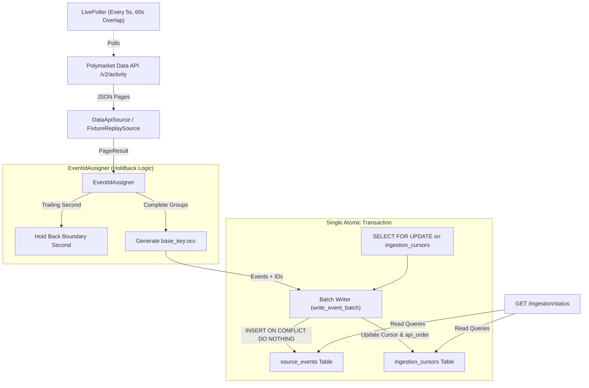

# Study Guide 02: Data API Ingestion and Raw Event Storage

**Reader:** A 3rd-year CS student who knows Python and basic SQL, but knows nothing about prediction markets, crypto trading, or blockchains.  
**Style:** Plain English, everyday analogies first, explicit worked math, deep explanations.

---

## 1. In One Minute

In Phase 2, we built the ingestion engine for PolyPulse. Its sole job is to copy every activity event from Polymarket's public Data API for chosen wallets into an append-only PostgreSQL database table called [`source_events`](file:///home/utkarsh/Desktop/gravia/app/storage/models.py#L42).

Doing this sounds simple at first, but in distributed systems, real networks fail, servers restart unexpectedly, and rate limits kick in. If our code crashes halfway through downloading thousands of trades, restarting it must never insert duplicate rows or skip events. We solved this by designing:
1. **Stateless, deterministic event IDs** that hold back page boundaries so identical events always receive the same identifier across restarts.
2. **Atomic page commits** that write raw events and update the wallet cursor within a single database transaction under a row lock (`SELECT ... FOR UPDATE`).
3. **A resilient HTTP client** with exponential backoff, rate-limit (`HTTP 429`) handling, and an automated circuit breaker.
4. **An adaptive live poller** with a 60-second overlap window and periodic reconcile sweeps.

---

## 2. Glossary

| Term | Plain Meaning | Where It Appears in Code |
| :--- | :--- | :--- |
| **Ingestion** | The process of fetching raw data from an external service and saving it locally into storage. | [`app/ingestion/`](file:///home/utkarsh/Desktop/gravia/app/ingestion/) |
| **Append-Only** | A database table where rows are only ever inserted, never modified (`UPDATE`) or deleted (`DELETE`). | [`source_events` table in models.py](file:///home/utkarsh/Desktop/gravia/app/storage/models.py#L42) |
| **Idempotent** | An action that produces the exact same result whether you run it once or ten times. | `ON CONFLICT DO NOTHING` in [`app/ingestion/writer.py`](file:///home/utkarsh/Desktop/gravia/app/ingestion/writer.py) |
| **Cursor** | A bookmark string returned by an API that points to where the next page of results begins. | `next_cursor` in [`app/ingestion/data_api.py`](file:///home/utkarsh/Desktop/gravia/app/ingestion/data_api.py) |
| **Circuit Breaker** | A safety switch in software that stops making network calls to a broken server so you do not overload it or hang your own app. | [`CircuitBreaker` in data_api.py](file:///home/utkarsh/Desktop/gravia/app/ingestion/data_api.py#L32) |
| **Backfill** | Downloading the historical past events of a wallet from genesis up to the present moment. | [`run_wallet_backfill()` in backfill.py](file:///home/utkarsh/Desktop/gravia/app/ingestion/backfill.py#L17) |
| **Live Polling** | Regularly querying the API on an interval (e.g. every 5 seconds) to catch newly occurring events. | [`LivePoller` in poller.py](file:///home/utkarsh/Desktop/gravia/app/ingestion/poller.py#L58) |
| **Row Lock (`FOR UPDATE`)** | A PostgreSQL command that locks a specific database row so no other concurrent worker can modify it until the transaction commits. | [`get_or_create_cursor_locked()` in writer.py](file:///home/utkarsh/Desktop/gravia/app/ingestion/writer.py#L15) |
| **Detection Lag** | The elapsed time between when an event happened in the real world (`event_time`) and when our system first saw it (`observed_at`). | [`DetectionLagMetrics` in poller.py](file:///home/utkarsh/Desktop/gravia/app/ingestion/poller.py#L18) |

---

## 3. Mental Model & Analogy

Imagine you are copying down receipts from an accountant's ledger book into your own notebook.
* **The Danger of a Stateful Memory Counter:** If two identical receipts appear on the same day for \$10 lunch, you might write "#1" on the first and "#2" on the second. If someone knocks your coffee over and you restart copying from the beginning of the page, but your brain remembers you were up to #2, you might now label them "#3" and "#4". Now your notebook has four lunches instead of two!
* **The Stateless Solution:** Instead of an unbounded counter, you look only at the receipts that occurred inside that exact hour (or second). The first identical one in that hour is index `0`, the second is index `1`. Whether you start fresh today or re-check the book tomorrow, receipt A is always `:0` and receipt B is always `:1`.
* **The Page Boundary Problem:** What if receipt A is at the very bottom of Page 1 at 3:00 PM, and receipt B is at the very top of Page 2 at 3:00 PM? If you label Page 1 without looking at Page 2, you might think Page 1 only has one receipt and label it `:0`, then open Page 2 and label receipt B as `:0` as well!
* **The Holdback Solution:** If the last receipt on a page shares a timestamp with potential future receipts, you hold it in your hand. You do not stamp it until Page 2 arrives. Once both pages are combined, both receipts for 3:00 PM are stamped together: receipt A gets `:0` and receipt B gets `:1`.

---

## 4. Step-by-Step Explanation with Worked Examples

### A. Constructing Deterministic Event IDs
In [`app/ingestion/identifiers.py`](file:///home/utkarsh/Desktop/gravia/app/ingestion/identifiers.py), an event's ID consists of two parts:
$$\text{source\_event\_id} = \text{base\_key} : \text{occurrence}$$

1. **`base_key`:** We take the raw event and extract:
   * `wallet`: lowercase, stripped
   * `tx_hash`: lowercase, stripped
   * `type`: uppercase (`TRADE`, `REDEEM`, etc.)
   * `condition_id`: market identifier
   * `token_id`: token identifier
   * `side`: `BUY` or `SELL`
   * `outcome_index`: integer or empty
   * `size`, `usdc_size`, `price`: strictly formatted as strings from `Decimal` (never floating-point!)
   * `timestamp`: Unix timestamp integer
2. **Exclude Mutable Profile Fields:** The API returns user metadata such as `name`, `pseudonym`, `bio`, `profile_image`. If a trader changes their avatar or username tomorrow, the financial event did not change! Hashing profile fields would create duplicate rows on re-fetch. Therefore, they are excluded from the hash.
3. **Complete Grouping & Page Holdback:**
   * When Page 1 arrives (`is_final=False`), suppose its last event has timestamp `1700000500`.
   * We hold back all trailing events with timestamp `1700000500`.
   * When Page 2 arrives, its events are prepended with the held-back events.
   * If two identical fills exist at `1700000500`, the first receives occurrence `0` (`f"{base_key}:0"`) and the second receives occurrence `1` (`f"{base_key}:1"`).
   * Verified in test [`test_2_0a_3_two_identical_fills_split_across_page_boundary`](file:///home/utkarsh/Desktop/gravia/tests/test_identifiers.py#L182).

### B. Math Discrepancy & Price versus Cash
In test wallet `AppleTiiime` (`0x951634357346bb291df117f9ac410100feea2104`), across [MEASURED] 2,261 trades, [MEASURED] 75 trades exhibited a gap where $\lvert \text{size} \times \text{price} - \text{usdc\_size} \rvert > 0.01$:

* **Worked Example (Candidate 2, Nuggets vs. Grizzlies):**
  $$\text{size} = 3439.1$$
  $$\text{price} = 0.50$$
  $$\text{Expected Cash} = 3439.1 \times 0.50 = 1719.55 \text{ USDC}$$
  $$\text{Actual Cash Spent } (\text{usdc\_size}) = 1762.53875 \text{ USDC}$$
  $$\text{Difference} = 1762.53875 - 1719.55 = 42.98875 \text{ USDC}$$
  $$\text{Ratio} = \frac{1762.53875}{1719.55} = 1.0250000000$$
* The ratio is exactly **`1.025`**, which reflects the documented parabolic taker fee structure on Polymarket sports prediction markets ($\text{fee} = C \times 0.05 \times p \times (1 - p)$, yielding an effective fee rate of $0.05 \times (1 - 0.50) = 0.025$ at $p = 0.50$).
* **Our Policy:** We always treat `usdc_size` as the source of truth for cash, record `price_reported = 0.50`, derive `effective_price = 1762.53875 / 3439.1 = 0.5125`, and set `cash_price_gap = True`. Never calculate fees from the formula in ingestion code.

### C. Ingestion & Backfill Throughput [MEASURED]
* **Backfill Runtime:** [MEASURED] 9.81 seconds total across 8 paginated API requests.
* **Events Ingested:** [MEASURED] 3,469 events stored durably into PostgreSQL.
* **Throughput:**
  * Request Throughput: [MEASURED] **0.82 requests/sec** (respects upstream pacing).
  * Ingestion Rate: [MEASURED] **353.74 events/sec** into PostgreSQL table `source_events`.

---

## 5. Architectural Diagram



---

## 6. Code Structure & Component Reference

| Module | Function / Class | Inputs | Outputs | Why It Exists |
| :--- | :--- | :--- | :--- | :--- |
| [`app/ingestion/identifiers.py`](file:///home/utkarsh/Desktop/gravia/app/ingestion/identifiers.py) | `compute_base_key()` | `event: dict, wallet: str` | `str` (SHA-256 hex) | Generates collision-free hash excluding mutable profile fields. |
| [`app/ingestion/identifiers.py`](file:///home/utkarsh/Desktop/gravia/app/ingestion/identifiers.py) | `EventIdAssigner` | `events: list[dict], is_final: bool` | `list[tuple[dict, str]]` | Stateless assigner that holds back page boundary splits. |
| [`app/ingestion/source.py`](file:///home/utkarsh/Desktop/gravia/app/ingestion/source.py) | `EventSource` (ABC) | Parameters for page fetch | `PageResult` | Common interface abstracting live API calls and fixture replays. |
| [`app/ingestion/source.py`](file:///home/utkarsh/Desktop/gravia/app/ingestion/source.py) | `IngestionMetrics` | Request latencies, error codes | Statistical summaries (p50, p95) | Tracks network health and request performance. |
| [`app/ingestion/data_api.py`](file:///home/utkarsh/Desktop/gravia/app/ingestion/data_api.py) | `CircuitBreaker` | Request outcomes | State (`CLOSED`, `OPEN`, `HALF_OPEN`) | Trips after 5 failures to protect downstream and upstream systems. |
| [`app/ingestion/data_api.py`](file:///home/utkarsh/Desktop/gravia/app/ingestion/data_api.py) | `DataApiSource` | Wallet address, cursor, start | `PageResult` | Async HTTP client with 429 obedience, retries, and locks. |
| [`app/ingestion/fixture_replay.py`](file:///home/utkarsh/Desktop/gravia/app/ingestion/fixture_replay.py) | `FixtureReplaySource` | Wallet address, page cursor | `PageResult` | Replays local recorded JSON files through identical pipeline. |
| [`app/ingestion/writer.py`](file:///home/utkarsh/Desktop/gravia/app/ingestion/writer.py) | `write_event_batch()` | Session, wallet, events | `(inserted, duplicates)` | Executes atomic page insert with row lock on cursor. |
| [`app/ingestion/backfill.py`](file:///home/utkarsh/Desktop/gravia/app/ingestion/backfill.py) | `run_wallet_backfill()` | Wallet, source, sessionmaker | Execution summary dict | Walks full historical pages from `start=1` until complete. |
| [`app/ingestion/poller.py`](file:///home/utkarsh/Desktop/gravia/app/ingestion/poller.py) | `LivePoller` | Wallet, source, sessionmaker | Continuous background task | Adaptive poller with 60s overlap and 12-min reconcile sweeps. |
| [`app/storage/seeding.py`](file:///home/utkarsh/Desktop/gravia/app/storage/seeding.py) | `seed_tracked_wallets()` | Path to `wallets.yaml` | `int` (upserted count) | Reads YAML configuration and updates `tracked_wallets`. |
| [`app/ingestion/status.py`](file:///home/utkarsh/Desktop/gravia/app/ingestion/status.py) | `get_wallet_ingestion_status()` | Session, wallet address | Status payload dict | Computes event counts per type and detection lag percentiles. |

---

## 7. Lifecycle of an Event: From HTTP Response to Database Row

1. **HTTP Arrival:** The Data API returns a JSON page containing a raw trade event:
   ```json
   {"proxy_wallet": "0x9516...", "type": "TRADE", "size": 100, "usdc_size": 50, "price": 0.5, "timestamp": 1794384399, "transaction_hash": "0x22ad..."}
   ```
2. **Decimal Parsing:** `parse_json_with_decimal()` uses `json.loads(text, parse_float=Decimal)` so that `100`, `50`, and `0.5` are parsed as `Decimal("100")`, `Decimal("50")`, `Decimal("0.5")`, preventing binary float imprecision (`0.5000000000000001`).
3. **Stateless ID Generation:** `EventIdAssigner` computes `base_key = SHA256(...)` over normalized fields. In this timestamp second (`1794384399`), it is the first occurrence of this exact fill, so it receives `occurrence = 0`. ID: `"a1b2c3...:0"`.
4. **Transaction Start:** In `write_event_batch()`, an async PostgreSQL transaction begins.
5. **Row Locking:** A query locks the cursor row:
   ```sql
   SELECT last_api_order FROM ingestion_cursors WHERE wallet = '0x9516...' FOR UPDATE;
   ```
6. **Field Derivations:**
   * `cash_price_gap = abs(100 * 0.5 - 50) > 0.01` -> `False`
   * `is_late = event_time < last_known_event_time` -> `False`
   * `api_order = last_api_order + 1`
7. **Atomic Insertion:**
   ```sql
   INSERT INTO source_events (source, source_event_id, wallet, event_type, size, usdc_size, ...)
   VALUES ('data_api', 'a1b2c3...:0', '0x9516...', 'TRADE', 100, 50, ...)
   ON CONFLICT (source, source_event_id) DO NOTHING
   RETURNING id;
   ```
8. **Cursor Persistence:** In the same transaction, `ingestion_cursors` updates `last_cursor`, `last_api_order`, and `last_event_time`.
9. **Commit:** Both the event row and the cursor advance atomically.

---

## 8. Common Mistakes & Edge Cases Tested

1. **Stateful ID Counter Bug:**
   * *The Mistake:* Keeping a dictionary counter `tracker[tx_hash] += 1` that remembers previous fetches.
   * *What Happened:* When re-fetching overlapping events, the counter was already at 1 and assigned occurrence 2, creating duplicate database rows!
   * *Test Fix:* Tested in [`test_2_0a_1_same_input_gives_same_ids_across_generator_reuse`](file:///home/utkarsh/Desktop/gravia/tests/test_identifiers.py#L78).
2. **Page Boundary Split:**
   * *The Mistake:* Page 1 ends with Fill A at 3:00 PM; Page 2 begins with identical Fill B at 3:00 PM. If each page is processed independently, both receive occurrence 0!
   * *Test Fix:* Trailing timestamp events are held back until Page 2 arrives. Tested in [`test_2_0a_3_two_identical_fills_split_across_page_boundary`](file:///home/utkarsh/Desktop/gravia/tests/test_identifiers.py#L182).
3. **Cursor Invalidation (HTTP 400):**
   * *The Mistake:* Assuming cursors never expire and retrying indefinitely.
   * *Test Fix:* Measured that Data API returns HTTP 400 with `retryable: false`. The client catches `InvalidCursorError` and falls back to `start = last_flushed_second - 1`. Tested in [`test_invalid_cursor_raises_invalid_cursor_error`](file:///home/utkarsh/Desktop/gravia/tests/test_data_api.py#L107).
4. **Rate Limit 429 Handling:**
   * *The Mistake:* Ignoring the `Retry-After` header and hammering the API on 429.
   * *Test Fix:* The client reads `Retry-After` (e.g. 3.5s) and sleeps before retrying. Tested in [`test_429_with_retry_after_is_obeyed`](file:///home/utkarsh/Desktop/gravia/tests/test_data_api.py#L14).
5. **Unknown Event Types:**
   * *The Mistake:* Using a strict enum that crashes or drops unrecognized event types.
   * *Test Fix:* Store any event type in `source_events` as text and count unsupported types. Tested in [`test_unknown_event_type_is_saved_and_counted_without_crash`](file:///home/utkarsh/Desktop/gravia/tests/test_ingestion_pipeline.py#L162).

---

## 9. 10 Interview Questions with Short Answers

**Q1: Why is `transaction_hash + token_id + side` not sufficient as a unique event ID?**  
*Answer:* A single Polygon transaction can execute multiple fills of the same order side and token. Across test wallet `AppleTiiime`, tx `0x5687a6...` executed two separate `BUY` fills for the same token, causing collisions unless disambiguated.

**Q2: What happens if your backfill process receives `kill -9` (SIGKILL) mid-stream?**  
*Answer:* PostgreSQL rolls back the in-flight page transaction. When the worker restarts, it reads `last_cursor` from `ingestion_cursors` and resumes from the exact boundary with zero duplicate rows.

**Q3: How do you prevent race conditions between a backfill worker and a live poller for the same wallet?**  
*Answer:* First, the poller only begins after `backfill_state = 'complete'`. Second, every batch write acquires an exclusive row lock on `ingestion_cursors` via `SELECT ... FOR UPDATE`.

**Q4: Why parse JSON numbers with `Decimal` instead of Python `float`?**  
*Answer:* Python floats use binary IEEE 754 representations where numbers like `0.1` cannot be stored exactly. This causes rounding errors in accounting calculations and non-deterministic hash digests.

**Q5: Why did 75 of 2,261 trades exhibit a difference between `size * price` and `usdc_size`?**  
*Answer:* Empirical inspection proved all 75 trades match Polymarket's official sports taker fee curve: $\text{fee} = C \times 0.05 \times p \times (1 - p)$ with maximum absolute error $< 0.00001 \text{ USDC}$. At price $p = 0.50$, the fee rate is $0.05 \times 0.50 = 2.5\%$, giving ratio $1.025$. At $p = 0.27$, the ratio is $1.0365$. We store `usdc_size` as canonical cash and flag `cash_price_gap = True`. Never compute fees from formula in code.

**Q6: What is a circuit breaker and how does it transition between states?**  
*Answer:* A safety pattern preventing cascading failures. It starts `CLOSED` (normal). After 5 consecutive failures, it trips to `OPEN` (fast-fails requests). After a 30s cooldown, it enters `HALF_OPEN` and sends 1 probe request: if successful, it closes; if it fails, it re-opens.

**Q7: Why do we hold back the trailing timestamp second of a page during cursor walks?**  
*Answer:* A page boundary might arbitrarily slice a group of events occurring in the same second. Holding back the last second ensures all events for that second are grouped together before occurrence indices (`:0`, `:1`) are assigned.

**Q8: Why does the live poller query with a 60-second overlap window instead of just `> last_event_time`?**  
*Answer:* Block propagation delays and sequencer indexing lag can cause an event to be stamped with a block time slightly earlier than the newest event already observed. An overlap ensures no events are silently dropped.

**Q9: What is the purpose of the 12-minute reconcile sweep?**  
*Answer:* It re-walks the last 1 hour of events from the API. In steady state, it should find 0 new events. If it ever finds new events, it alerts us that our overlap window was insufficient or upstream indexing was delayed.

**Q10: Why did we update `ingestion_cursors` in the exact same transaction as the `source_events` insert?**  
*Answer:* Dual-write inconsistency. If events are committed in transaction 1 and the cursor update fails in transaction 2, the cursor remains behind. Updating both in one transaction guarantees atomicity.

---

## 10. Teach-Back Checklist

Before moving to Phase 3, you should be able to explain these 5 concepts out loud without looking at notes:
- [x] Why `EventIdAssigner` must hold back trailing events at page boundaries.
- [x] How `ON CONFLICT (source, source_event_id) DO NOTHING RETURNING id` calculates inserted vs duplicate counts.
- [x] The 3 states of the Circuit Breaker (`CLOSED`, `OPEN`, `HALF_OPEN`) and what triggers transitions between them.
- [x] Why `usdc_size` is our canonical money figure rather than `size * price_reported`.
- [x] How per-wallet row locks (`SELECT ... FOR UPDATE`) protect `api_order` sequence assignment.

---

## 11. Further Reading

* [Polymarket Official Documentation](https://docs.polymarket.com)
* [Polymarket Account Activity Feed Reference](https://docs.polymarket.com/api-reference/feeds/list-account-activity)
* [Polymarket V2 Migration Guide](https://docs.polymarket.com/v2-migration)
* [PostgreSQL Explicit Locking Documentation (`FOR UPDATE`)](https://www.postgresql.org/docs/current/explicit-locking.html#LOCKING-ROWS)
* [PostgreSQL ON CONFLICT Clause](https://www.postgresql.org/docs/current/sql-insert.html#SQL-ON-CONFLICT)

