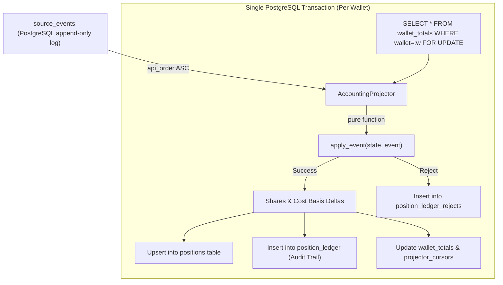

# Study Guide 03: Deterministic Accounting & PnL Engine

**Reader:** A 3rd-year CS student who knows Python and basic SQL, but knows nothing about prediction markets, financial accounting, or blockchains.  
**Style:** Plain English, everyday analogies first, explicit worked math, deep explanations.

---

## 1. In One Minute

In Phase 3, we built the **Accounting and Profit-and-Loss (PnL) Engine** for PolyPulse.

Its sole job is to read raw prediction market events from PostgreSQL's append-only [`source_events`](file:///home/utkarsh/Desktop/gravia/app/storage/models.py#L48) table in chronological sequence (`api_order`), and calculate:
1. Exactly how many outcome shares each wallet currently owns (`positions`).
2. The blended average cost paid per share (`avg_cost_basis`).
3. Exactly how much cash profit or loss has been locked in (`realized_pnl` on `wallet_totals`).
4. An immutable audit trail proving every single balance mutation (`position_ledger`).

Everything runs on exact, arbitrary-precision decimal math (`Decimal` with 28 digits of precision)—**zero floats allowed**. If any event arrives out of order or a server crashes mid-calculation, the system can wipe the derived state and deterministically rebuild it from the raw event log in seconds.

---

## 2. Glossary

| Term | Plain Meaning | Where It Appears in Code |
| :--- | :--- | :--- |
| **Position** | How many shares of a specific event outcome (e.g., "Yes" on Lakers winning) a wallet holds right now. | [`app/storage/models.py:Position`](file:///home/utkarsh/Desktop/gravia/app/storage/models.py#L113) |
| **Cost Basis** | The average amount of cash you paid per share across all your purchases. | `Position.avg_cost_basis` |
| **Realized PnL** | Profit or Loss that is permanently locked in because you sold shares or redeemed winning tokens for cash. | `WalletTotal.total_realized_pnl` |
| **Unrealized PnL** | "Paper" profit or loss based on current market price of shares you still hold. Not locked in. | Calculated at serving time (Phase 5). |
| **Projector** | A worker that reads events one by one from the raw log and "projects" them into current balances and ledger entries. | [`app/accounting/projector.py:AccountingProjector`](file:///home/utkarsh/Desktop/gravia/app/accounting/projector.py#L33) |
| **Audit Ledger** | An append-only historical log recording before-and-after shares, cash deltas, and PnL deltas for every state change. | [`app/storage/models.py:PositionLedger`](file:///home/utkarsh/Desktop/gravia/app/storage/models.py#L173) |
| **REDEEM** | When a market resolves, turning winning outcome shares back into USDC cash. | [`app/accounting/engine.py:apply_event`](file:///home/utkarsh/Desktop/gravia/app/accounting/engine.py#L131) |

---

## 3. Mental Model with an Everyday Analogy

### The Coffee Bean Jar Analogy

Imagine you have a glass jar on your kitchen counter:

1. **First Purchase (BUY):**
   * On Monday, you buy 100 grams of coffee beans for \$10.
   * You have 100 grams in the jar. Your average cost is $\frac{\$10}{100\text{g}} = \$0.10/\text{gram}$.
2. **Second Purchase (BUY at a higher price):**
   * On Tuesday, prices go up. You buy another 100 grams for \$20 and pour them into the same jar.
   * You now have 200 grams. You spent \$30 total.
   * Your new **blended average cost** is $\frac{\$10 + \$20}{200\text{g}} = \frac{\$30}{200\text{g}} = \$0.15/\text{gram}$.
3. **Selling to your neighbor (SELL):**
   * On Wednesday, your neighbor buys 50 grams from you for \$15 (\$0.30/gram).
   * **What was your cost for those 50 grams?** Exactly $50 \times \$0.15 = \$7.50$.
   * **What is your Realized Profit?** $\$15\text{ (cash received)} - \$7.50\text{ (cost)} = \mathbf{\$7.50}$.
   * **What is the average cost of the 150 grams left in your jar?** Still exactly **\$0.15/gram**! Selling some beans does not change what you paid for the beans still sitting in the jar.
4. **Emptying the jar (REDEEM):**
   * On Thursday, the coffee company buys back whatever is left in the jar for \$30.
   * You surrender all 150 grams. Your cost basis was $150 \times \$0.15 = \$22.50$.
   * Your realized profit is $\$30 - \$22.50 = \mathbf{\$7.50}$. Your jar now holds 0 grams.

**Key Rule:** Price fluctuations in the store don't create *realized* profit. Profit only crystallizes into your wallet when cash changes hands (a SELL or a REDEEM).

---

## 4. Step-by-Step Worked Math Examples

All math below is taken directly from our unit test suite [`tests/test_accounting_engine.py`](file:///home/utkarsh/Desktop/gravia/tests/test_accounting_engine.py).

### Example 1: Three Buys, a Partial Sell, and a Losing Redeem
Let's trace a wallet executing trades on Outcome Token `0xTokenA`:

#### Step 1: BUY 100 shares for 40 USDC (Price 0.40)
* $S_{after} = 0 + 100 = 100\text{ shares}$
* $C_{after} = \frac{40\text{ USDC}}{100} = 0.4000\text{ USDC/share}$
* $\text{Realized PnL} = 0\text{ USDC}$

#### Step 2: BUY 100 shares for 60 USDC (Price 0.60)
* $S_{after} = 100 + 100 = 200\text{ shares}$
* $C_{after} = \frac{(100 \times 0.40) + 60}{200} = \frac{40 + 60}{200} = \frac{100}{200} = 0.5000\text{ USDC/share}$
* $\text{Realized PnL} = 0\text{ USDC}$

#### Step 3: Partial SELL 50 shares for 40 USDC (Price 0.80)
* $S_{after} = 200 - 50 = 150\text{ shares}$
* $C_{after} = 0.5000\text{ USDC/share}\text{ (unchanged)}$
* $\text{Cost of shares sold} = 50 \times 0.5000 = 25.00\text{ USDC}$
* $\Delta\text{Realized PnL} = 40.00\text{ (proceeds)} - 25.00\text{ (cost)} = \mathbf{+15.00\text{ USDC}}$
* Total Realized PnL so far: $+15.00\text{ USDC}$

#### Step 4: REDEEM with 0 USDC Payout (Market Resolves Against Trader)
* The market resolved to "No", so the trader's "Yes" shares are worth 0.
* $S_{after} = 0\text{ shares}$
* Cost of remaining shares surrendered: $150 \times 0.5000 = 75.00\text{ USDC}$
* Proceeds received: $0.00\text{ USDC}$
* $\Delta\text{Realized PnL} = 0.00 - 75.00 = \mathbf{-75.00\text{ USDC}}$
* **Cumulative Realized PnL:** $+15.00 - 75.00 = \mathbf{-60.00\text{ USDC}}$

#### Invariant Verification (Cash Flow Reconciliation):
* Total Cash Spent on Buys: $40 + 60 = 100\text{ USDC}$
* Total Cash Received from Sells: $40\text{ USDC}$
* Net Cash Outflow: $40 - 100 = \mathbf{-60.00\text{ USDC}}$
* Net Cash Flow equals Cumulative Realized PnL exactly ($-60.00 = -60.00$)!

---

## 5. Architectural Flow Diagram

---

## 6. Code Map: Files and Functions

| Component | What it does | Input | Output | Why it exists |
| :--- | :--- | :--- | :--- | :--- |
| [`apply_event`](file:///home/utkarsh/Desktop/gravia/app/accounting/engine.py#L20) | Pure transition function for token state | `(PositionState, AccountingEvent)` | `ApplyResult` | Guarantees deterministic, testable arithmetic isolated from database I/O. |
| [`AccountingProjector.catch_up_wallet`](file:///home/utkarsh/Desktop/gravia/app/accounting/projector.py#L68) | Applies unapplied events from cursor forward | `(session, wallet, batch_size)` | `ProjectorRunSummary` | Regular forward processing of incoming trades. |
| [`AccountingProjector.recompute_wallet`](file:///home/utkarsh/Desktop/gravia/app/accounting/projector.py#L114) | Wipes derived state and replays entire wallet | `(session, wallet)` | `ProjectorRunSummary` | Self-healing recovery path for late events or audit rebuilds. |
| [`verify_wallet_rebuild`](file:///home/utkarsh/Desktop/gravia/scripts/verify_rebuild.py#L18) | Verifies Rule 4: sums audit ledger vs positions | `(wallet)` | `bool` | Automated mathematical proof that derived tables equal the ledger. |
| [`scripts/chaos_accounting.py`](file:///home/utkarsh/Desktop/gravia/scripts/chaos_accounting.py#L25) | Chaos resilience test with `SIGKILL` | 5 random kill trials | Test report | Proves atomic transaction rollback under process termination. |

---

## 7. Tracing One Event End-to-End

Let's trace how a BUY trade is processed from storage to ledger:
1. `source_events` contains row: `event_type='TRADE', side='BUY', size=100, usdc_size=40, api_order=42`.
2. `catch_up_wallet` begins an async transaction and runs `SELECT * FROM wallet_totals WHERE wallet = '0x...' FOR UPDATE`. This row lock prevents any second worker from racing.
3. The projector reads `last_applied_api_order` (41) and fetches row 42.
4. The current `PositionState` for `(condition_id, token_id)` is fetched from the in-memory batch cache.
5. The projector invokes pure function `apply_event(current_state, event)`.
6. `apply_event` adds 100 shares, updates the weighted average cost basis, calculates `realized_pnl_delta = 0`, and returns `ApplySuccess`.
7. The projector stages an immutable row into `position_ledger` recording:
   * `shares_before`: 0
   * `shares_delta`: +100
   * `shares_after`: 100
   * `avg_cost_after`: 0.4000
   * `cash_delta`: -40.00
8. The `Position` row is upserted, `wallet_totals.last_applied_api_order` advances to 42, and the transaction commits.

---

## 8. Common Mistakes and Edge Cases Handled

1. **Selling More Than Held (`SELLING_MORE_THAN_HELD`):**
   * *Problem:* A wallet transfers in tokens on-chain (or mints via split) without a secondary market BUY trade in our history, then issues a SELL.
   * *Solution:* We never allow shares to go negative. The event is rejected to `position_ledger_rejects`, logged with the reason, and wallet processing continues without crashing.
2. **Repeating Decimal Division (e.g. 1/3 shares):**
   * *Problem:* Floating-point math introduces binary rounding errors ($0.33333333333333331$), corrupting PnL by pennies over thousands of trades.
   * *Solution:* We configure Python's `decimal` context to 28 significant digits. All arithmetic is strictly `Decimal`.
3. **Zero-Payout REDEEMs (Losing Predictions):**
   * *Problem:* A programmer might write an `if usdc_size == 0: pass`, forgetting that losing shares still represent a locked-in capital loss.
   * *Solution:* We treat REDEEM as a sell at proceeds `usdc_size`. When `usdc_size = 0`, the formula naturally crystallizes $\text{proceeds} - \text{cost} = 0 - \text{cost} = -\text{cost}$ (100% loss).
4. **Resolved But Unredeemed Markets (Open Question 5):**
   * *Problem:* Inferring a winning market is worth \$1.00 before redemption creates "Phantom Math".
   * *Solution:* We follow **No Phantom Math**: accounting leaves the position open until an actual `REDEEM` event occurs.

---

## 9. 10 Out-Loud Interview Questions for Gravia.trade

### Q1: What happens, end to end, if an event arrives 3 days late?
**Answer:** The ingestion poller tags the event with `is_late = True`. The accounting projector detects this, acquires an exclusive `SELECT ... FOR UPDATE` row lock on `wallet_totals`, deletes the derived `positions` and `position_ledger` rows for that wallet, and replays all source events from sequence `api_order = 1` in order. The lock ensures no reader or worker sees half-computed state.

### Q2: Why is a row lock on `wallet_totals` sufficient concurrency control?
**Answer:** Because hot position state is strictly per-wallet. Two wallets never touch the same position rows. A row lock on `wallet_totals` perfectly serializes concurrent catch-up or recompute runs on the same wallet while permitting 100% parallel execution across different wallets without global database contention.

### Q3: Why didn't you special-case zero-payout REDEEMs?
**Answer:** Because mathematically, a redemption is identical to closing a position at the redemption proceeds. When proceeds are 0, $\text{Realized PnL} = 0 - \text{Cost Basis} = -\text{Cost Basis}$, which correctly registers the loss without requiring any special branch or synthetic code path.

### Q4: Why did you build an audit ledger (`position_ledger`) instead of just mutating `positions`?
**Answer:** Rule 4 of our engineering brief states that every derived number must be rebuildable and verifiable. With `position_ledger`, we can mathematically prove correctness by re-summing `shares_delta` and `realized_pnl_delta` to ensure they match current balances to the exact decimal.

### Q5: What would break if positions were sharded across database instances by wallet?
**Answer:** Sharding by wallet would prevent cross-wallet leaderboards and global PnL aggregation without costly distributed transactions. By keeping hot aggregate state on a single PostgreSQL instance and partitioning historical event tables by time, we achieve high throughput with ACID guarantees.

### Q6: What would you change if a wallet had 50 million events instead of 3,000?
**Answer:** A full replay from event 0 would become too expensive. We would introduce periodic **state checkpoints** (e.g. every 10,000 events or monthly snapshots). A late event would only replay from the checkpoint immediately preceding the late event's timestamp.

### Q7: Why do you store `usdc_size` instead of computing `size * price_reported`?
**Answer:** In Phase 2, we empirically measured that 3.3% of trades on Polymarket sports prediction markets pay a parabolic taker fee ($\text{fee} = C \times 0.05 \times p \times (1 - p)$). The actual cash debited is `usdc_size`. Computing cash from price would systematically miscalculate cash outflows and distort PnL.

### Q8: What is the difference between Realized and Unrealized PnL in PolyPulse?
**Answer:** Realized PnL is cash profit or loss locked in via executed trades and redemptions. Unrealized PnL is mark-to-market paper gain based on live WebSocket market prices. The accounting engine only handles Realized PnL; Unrealized PnL is computed at serving time in the API layer.

### Q9: Why is `apply_event` written as a pure function?
**Answer:** A pure function takes inputs and produces outputs with no database I/O or state mutations. This allowed us to write property-based tests (Hypothesis) generating thousands of random trade sequences and verifying invariants in milliseconds without database overhead.

### Q10: How does the system handle process crashes (`SIGKILL`) during recompute?
**Answer:** Because the deletion of old positions and insertion of replayed positions occur within a single database transaction, PostgreSQL's Write-Ahead Log (WAL) guarantees atomic rollback on process termination. In our chaos test, 5 out of 5 `SIGKILL` interruptions recovered with 100% byte-identical state.

---

## 10. Teach-Back Checklist (5 Things to Explain Out Loud)

1. **The Weighted Average Cost Formula:** Be able to write $C_{new} = \frac{(C_{old} \times S_{old}) + \text{cash}}{S_{new}}$ on a whiteboard.
2. **Why Sells Do Not Change Average Cost:** Explain why selling 10 shares of stock doesn't alter what you paid for the remaining 90 shares.
3. **The Cash Flow Reconciliation Invariant:** Explain why $\text{Realized PnL} = \text{Net Cash Flow} + (\text{Shares} \times \text{Avg Cost})$.
4. **The Recompute vs. Catch-up Relationship:** Explain why recompute is simply catch-up with cursor set to 0.
5. **The Concurrency Model:** Explain why `SELECT ... FOR UPDATE` on `wallet_totals` serializes writers per wallet.

---

## 11. Further Reading

* [Polymarket Official Fee Schedule](https://docs.polymarket.com/trading/fees)
* [Gnosis Conditional Tokens Framework (ERC-1155)](https://docs.gnosis.io/conditionaltokens/)
* [PostgreSQL Explicit Locking (`SELECT FOR UPDATE`)](https://www.postgresql.org/docs/current/explicit-locking.html)
* [Python `decimal` Fixed-Point & Floating-Point Arithmetic](https://docs.python.org/3/library/decimal.html)

