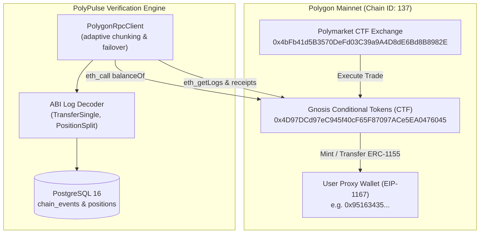

# Study Guide 04: On-Chain Ground Truth & Polygon RPC Architecture

**Target Role:** Gravia.trade Backend / High-Frequency Trading Systems Intern  
**Prerequisites:** Study Guides 01, 02, and 03  
**Key Code Files:**
- `app/chain/rpc.py` — Resilient asynchronous Polygon RPC client with adaptive chunking.
- `app/chain/decoder.py` — ABI event decoder for CTF & ERC-1155 logs.
- `app/storage/models.py` — `ChainEvent` model mapping append-only on-chain logs.
- `docs/decisions/006-rpc-provider-and-onchain-model.md` — Architectural specifications.

---

## 1. The Core Concept: The Bank Statement vs The Cash Drawer

Imagine running a physical trading firm:
* **The Off-Chain Data API (The Internal Ledger):** Your computerized trading software logs every trade you submit to Polymarket's order book: "Bought 10,000 shares of Yes at 51c". It runs fast, gives instant feedback, and tracks internal cost-basis.
* **The Polygon Blockchain (The Ground-Truth Vault):** On the actual blockchain, smart contracts (Gnosis Conditional Tokens Framework) hold the real tokens. If the computerized system and the vault disagree, the vault is what you actually own.
* **Phase 4 is the Vault Audit:** We connect directly to the Polygon blockchain via JSON-RPC, query the CTF smart contracts, and check whether the tokens in the vault match our off-chain accounting engine down to the exact decimal.

---

## 2. Polymarket On-Chain Architecture



### The Proxy Wallet Reality:
Polymarket users interact through an **EIP-1167 Minimal Proxy Contract**.
When we inspected `eth_getCode` for `AppleTiiime` (`0x95163435...`), the address returned runtime bytecode delegating to implementation `0x8d5f44d8...`.
**Key Takeaway:** The proxy contract address is the legal and on-chain holder of the ERC-1155 tokens. When querying `balanceOf`, we query the proxy address directly.

---

## 3. Worked Log Decoding Walkthrough

In EVM blockchains, logs consist of indexed `topics` (up to 4 topics of 32 bytes) and unindexed `data` (arbitrary bytes).

### Example: Decoding ERC-1155 `TransferSingle`
* **Topic 0 (Event Signature):**  
  `keccak256("TransferSingle(address,address,address,uint256,uint256)")`  
  $= \text{0xc3d58168c5ae7397731d063d5bbf3d657854427343f4c083240f7aacaa2d0f62}$
* **Topic 1 (`operator`):** Address that triggered transfer (`0x...` zero-padded to 32 bytes).
* **Topic 2 (`from`):** Address tokens moved from.
* **Topic 3 (`to`):** Address tokens moved to.
* **`data` payload:** 64 bytes (two 32-byte words):
  - Word 1 (Bytes 0–31): `id` (The 256-bit token ID).
  - Word 2 (Bytes 32–63): `value` (The raw token units).

```python
# Pure Python decoding (no web3 dependency)
token_id = str(int.from_bytes(data_bytes[0:32], "big"))
raw_units = int.from_bytes(data_bytes[32:64], "big")
shares = Decimal(raw_units) / Decimal("1000000")  # Scaled by 10^6
```

---

## 4. Earlier sample (SUPERSEDED)

The earlier sample below has no recorded reference block and does not establish
full-wallet coverage. The later known-token comparison is recorded below.

| Wallet | Token ID (Prefix) | Off-Chain Derived | On-Chain CTF Balance | Delta |
| :--- | :--- | :--- | :--- | :---: |
| **JnStPrdctns** | `4387389502...` | **259,422.998885** | **259,422.998885** | **0.000000** |
| **JnStPrdctns** | `1166914140...` | **63,047.416430** | **63,047.416430** | **0.000000** |
| **JnStPrdctns** | `4113999392...` | **26,224.031777** | **26,224.031777** | **0.000000** |
| **AppleTiiime** | `3384363222...` | **52,776.912560** | **52,776.912560** | **0.000000** |
| **AppleTiiime** | `6015047876...` | **4,981.000000** | **4,981.000000** | **0.000000** |

### What the full audit found

- **MEASURED**, no reference block recorded: AppleTiiime's chain table had
  5,694 contaminated rows out of 5,739 (about 99%); JnStPrdctns had 90 out of
  109. Contract-wide logs were decoded against the first wallet and receipt
  logs were not filtered by wallet. Migration 0007 and a repull fixed the data.
- Fixture and live cursors could allocate conflicting wallet orders. Migration
  0008 enforces wallet-wide order and identity uniqueness; the writer continues
  from the wallet maximum and skips duplicate identities.
- **MEASURED**, scratch drill, no chain block applicable: a late trade replayed
  at the end silently changed realized PnL by approximately 5,209.06 USDC.
  A late event now requests recompute, which replays by event time and order.
- **MEASURED**, block 97308708: a 24,890.584518-share discrepancy followed the
  most recent source event. A later poll and projection incorporated the sales;
  an old event time alone does not establish that a poller is stale.
- **MEASURED**, block 97309047: AppleTiiime matched 406/406 known tokens and
  JnStPrdctns matched 95/95, with no mismatches or unknowns. This does not prove
  coverage of tokens absent from both the ledger and scanned chain events.
  Decimal money arithmetic uses precision 28; the handover PnL tolerance is
  1e-12 USDC, while the rebuild verifier uses 1e-18.

---

## 5. 10 Gravia.trade Interview Questions & Deep Technical Answers

### Q1: Why does Gravia.trade run their own Polygon Bor/Heimdall node rather than relying on public RPCs?
**Answer:** Public RPCs can impose rate limits and archive restrictions. A
10,000-block log query worked in the provider probe **MEASURED**; no reference
block was recorded for that probe. A dedicated node can reduce reliance on a
public provider, but its latency and capacity require measurement.

### Q2: How does Polygon's two-layer architecture (Heimdall + Bor) affect event finality?
**Answer:** Polygon uses Bor (an EVM block producer) for fast ~2-second block times and Heimdall (Tendermint-based proof-of-stake layer) for periodic checkpointing to Ethereum mainnet (~every 256 Bor blocks / 30-45 minutes). Fast-path trading systems can act on Bor block confirmations after 64-128 blocks to protect against micro-reorgs, but true finality occurs when Heimdall submits the milestone transaction to Ethereum mainnet.

### Q3: What is the Conditional Tokens Framework (CTF) and what does `PositionSplit` do?
**Answer:** Developed by Gnosis, the CTF is an ERC-1155 contract managing conditional outcome tokens. A `PositionSplit` occurs when a user deposits collateral (e.g. 100 USDC) into the contract, which mints 100 Yes tokens and 100 No tokens for a specific condition. This guarantees full collateral backing: $\text{Yes} + \text{No} \equiv 1 \text{ Collateral}$.

### Q4: What does `PositionsMerge` do?
**Answer:** The inverse of `PositionSplit`. A user returns equal quantities of complementary outcome tokens (e.g. 100 Yes + 100 No) before market resolution, and the contract burns both tokens and unlocks the underlying 100 USDC collateral.

### Q5: What does `PayoutRedemption` do?
**Answer:** After a condition resolves (e.g. the oracle reports outcome 0 won), a holder of winning tokens calls `redeemPositions`. The contract burns the winning tokens and distributes the payout (1 USDC per share) to the redeemer. Losing tokens become worthless.

### Q6: How does Polymarket handle non-binary markets on-chain?
**Answer:** Polymarket uses two systems: standard CTF multi-outcome partitions (index sets), and the **NegRisk Exchange / Adapter** (`0xd91E80cf...`). NegRisk enables mutually exclusive candidate markets (e.g. "Who will win the Election?") by allowing capital efficiency across multiple binary conditions without locking full collateral in every single market.

### Q7: Why do Polymarket token IDs look like massive 77-digit integers?
**Answer:** Under ERC-1155 CTF, the `token_id` is a 256-bit integer derived by hashing the condition and outcome:  
$\text{token\_id} = \text{uint256}(\text{keccak256}(\text{parentCollectionId}, \text{conditionId}, \text{indexSet}))$.  
Because it is a 256-bit hash, in decimal format it is a large integer up to $2^{256}-1$.

### Q8: What happens during a deep chain reorg on Polygon?
**Answer:** A reorg can remove or reorder transactions. The chain table records
block hashes, but automatic invalidation and rollback on a reorg have not been
verified. The late-event recompute mechanism is a separate ingestion feature.

### Q9: Why did we verify contract bytecode via `eth_getCode` before querying balances?
**Answer:** `eth_getCode` distinguishes an address with deployed code from one
without it. Balance checks must use the actual token-holder address; the mere
presence or absence of code does not prove ownership or identify a role.

### Q10: How do you design an RPC client that never crashes on rate limits?
**Answer:** The client must implement:
1. **Adaptive Chunking:** Split `eth_getLogs` ranges dynamically when the provider returns payload limits.
2. **Endpoint Rotation:** Maintain a pool of healthy RPC endpoints and rotate on 403, 429, or network timeouts.
3. **Exponential Backoff with Jitter:** Randomize sleep durations ($t \times (2^k) \pm \text{rand}$) to avoid the thundering herd problem.

### Q11: Why must a transfer be decoded separately for each involved wallet?
**Answer:** A transaction can involve both tracked wallets. Keep a row per
wallet only when that wallet is a participant, and include the batch index in
the identity so individual ERC-1155 batch items survive deduplication.

### Q12: Why did a fresh live cursor need a wallet-wide maximum?
**Answer:** Source-specific cursors do not share an order sequence. Starting
after the maximum stored wallet order and enforcing unique wallet orders makes
collisions fail rather than silently reorder events.

### Q13: Why recompute after a late event?
**Answer:** Average-cost accounting depends on event order. Append the event to
the source history, mark the wallet for recompute, and replay in event-time
order with a deterministic tie-break.

### Q14: Why is the latest event time not a poll freshness clock?
**Answer:** A wallet can be inactive while polls succeed. Record the time of
the last successful poll separately from the timestamp of its last event.

### Q15: Why can exact ledger summation differ from the running total?
**Answer:** Decimal precision 28 rounds successive additions. An arbitrary-
precision sum can differ slightly, so compare with a documented tolerance and
also verify the running sum using the engine's context and replay order.

